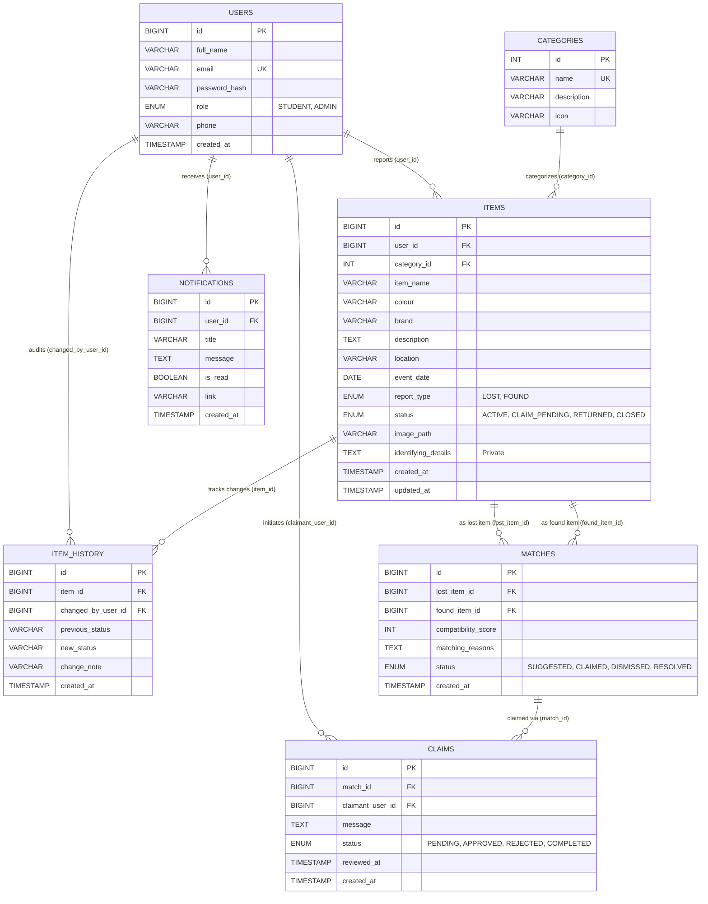

# FindIt: Database Architecture & ER Diagram

## 1. Entity-Relationship (ER) Diagram

---

## 2. Relational Schema & Cardinalities

1. **USERS (1) to ITEMS (M)**: One student or administrator can report zero, one, or multiple items. Each item is reported by exactly one user (`items.user_id` FK).
2. **CATEGORIES (1) to ITEMS (M)**: Each category can contain multiple items. Each item belongs to exactly one category (`items.category_id` FK).
3. **ITEMS (1) to MATCHES (M)**: Items can have multiple match relationships as either `lost_item_id` or `found_item_id`.
   - Associative relationship between LOST items and FOUND items with a UNIQUE constraint `(lost_item_id, found_item_id)` to prevent redundant pairs.
4. **MATCHES (1) to CLAIMS (M)**: A match recommendation can lead to one or more claims if contested, though normally one active claim exists per match.
5. **USERS (1) to CLAIMS (M)**: A claimant user can submit claims on multiple matches.
6. **USERS (1) to NOTIFICATIONS (M)**: One user receives many notifications.
7. **ITEMS (1) to ITEM_HISTORY (M)**: Audit log captures status transitions over time.

---

## 3. Database Normalization Analysis (Up to 3NF)

### First Normal Form (1NF)
- **Requirement**: Each table column contains only atomic (indivisible) values, every record has a unique primary key, and there are no repeating groups.
- **Compliance**:
  - All attributes like `full_name`, `email`, `item_name`, `colour`, `location`, `event_date` store atomic values.
  - No comma-delimited lists or multi-valued attributes exist within single fields.
  - Every table has a clearly defined surrogate Primary Key (`id` with `AUTO_INCREMENT`).

### Second Normal Form (2NF)
- **Requirement**: The relation must be in 1NF and all non-key attributes must be fully functionally dependent on the entire primary key (no partial dependencies on a composite key).
- **Compliance**:
  - All tables use single-attribute primary keys (`id`).
  - Therefore, partial dependency on a subset of a composite primary key is mathematically impossible.
  - Even in associative entities (`matches`), a surrogate PK `id` is used alongside candidate key `(lost_item_id, found_item_id)`, and attributes like `compatibility_score` and `matching_reasons` depend on the whole pair of items.

### Third Normal Form (3NF)
- **Requirement**: The relation must be in 2NF and contain no transitive dependencies (non-key attributes depending on other non-key attributes: $X \to Y \to Z$).
- **Compliance**:
  - In `items`, category details (`category_name`, `description`, `icon`) are **not** stored directly in the `items` table. Instead, a foreign key `category_id` references a normalized `categories` table. If category details were placed inside `items`, `items.id -> items.category_id -> categories.name` would be a transitive dependency violating 3NF.
  - Similarly, user details (`full_name`, `phone`) are not stored in `items`, `claims`, or `item_history`; only `user_id` is referenced.
  - Hence, every non-key attribute depends strictly on the primary key, the whole primary key, and nothing but the primary key.

---

## 4. Integrity Constraints & Business Rules

1. **Primary Key Constraints**: Enforces entity integrity across all tables.
2. **Foreign Key Constraints with Cascade**:
   - `ON DELETE CASCADE` on `items.user_id`, `matches.lost_item_id`, `claims.match_id`, ensuring no orphaned records exist when a test user or report is deleted.
   - `ON DELETE RESTRICT` on `items.category_id` to prevent deletion of a category while active items are assigned to it.
3. **Unique Constraints**:
   - `users.email` is UNIQUE to guarantee single account per email.
   - `categories.name` is UNIQUE to avoid duplicate category naming.
   - `matches (lost_item_id, found_item_id)` is UNIQUE to prevent redundant duplicate match calculations between the same two reports.
4. **Domain Check Constraints**:
   - `chk_score_range`: `compatibility_score BETWEEN 0 AND 100`.
   - `chk_different_items`: `lost_item_id <> found_item_id` ensures an item is never matched against itself.
   - `chk_user_email`: Basic email format validation at the database level.

